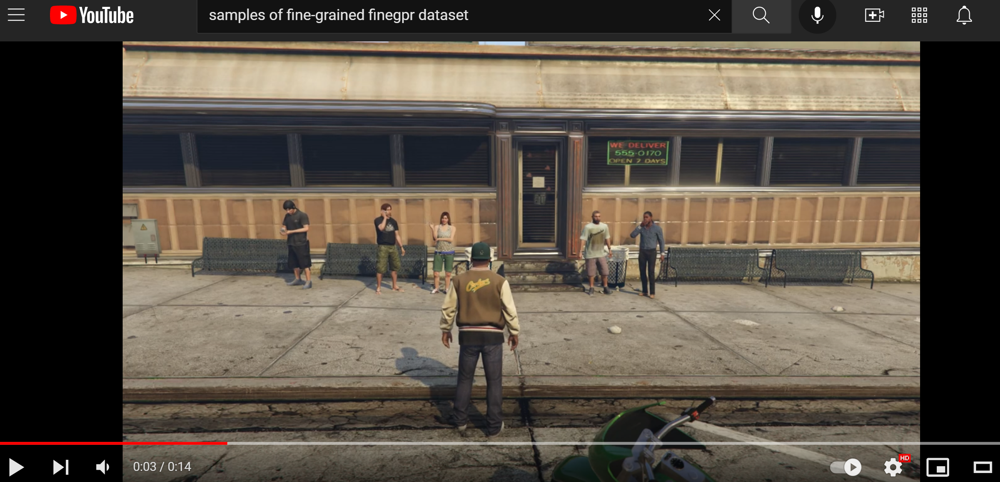
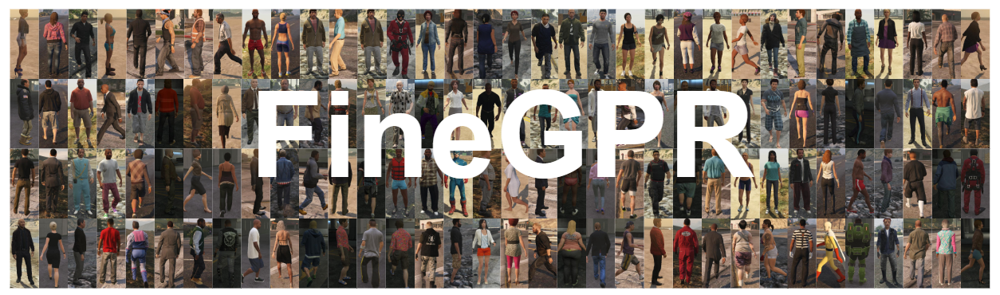
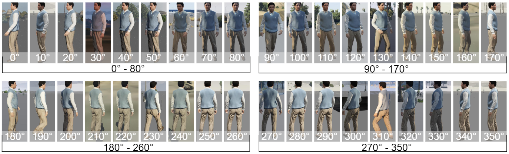
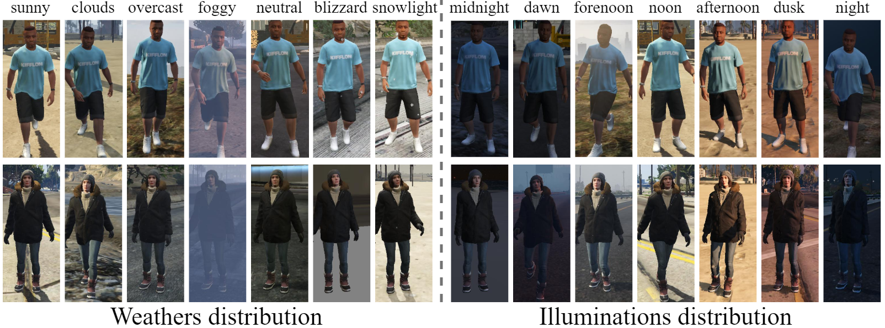
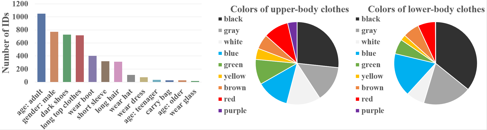
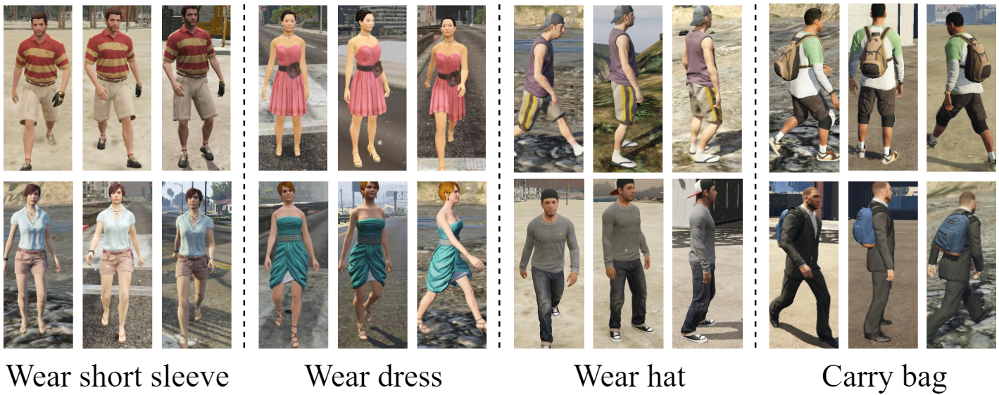
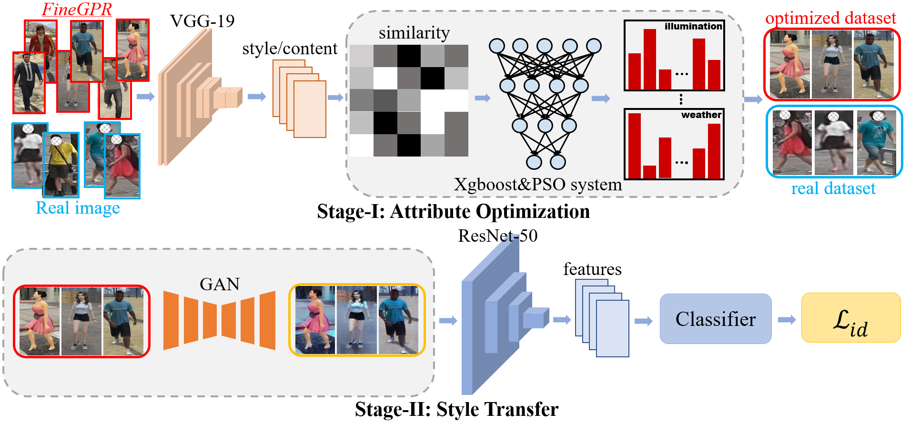
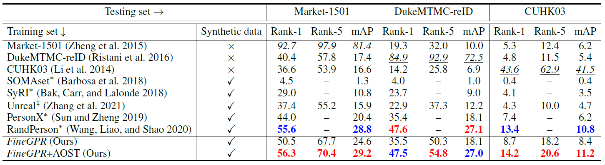
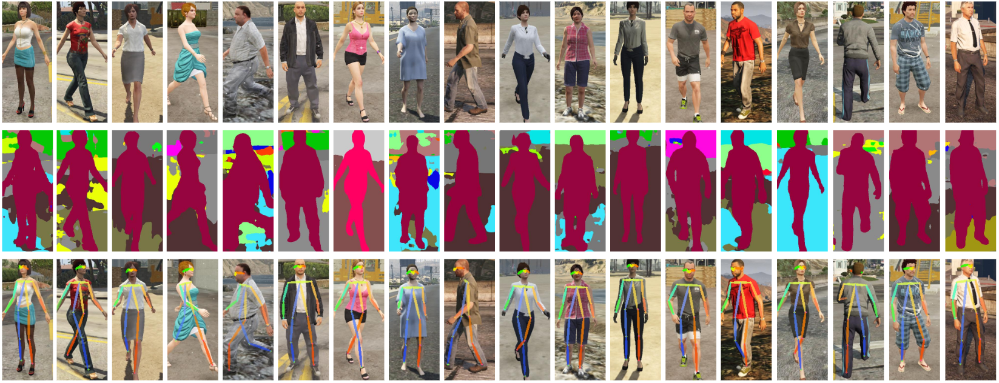
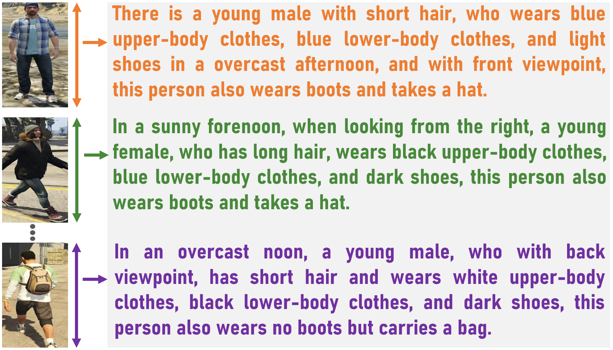

[](https://opensource.org/licenses/GPL-3.0)


# Less is More: Learning from Synthetic Data with Fine-grained Attributes for Person Re-Identification
### [Suncheng Xiang](https://JeremyXSC.github.io/)
### [Shanghai Jiao Tong University](https://en.sjtu.edu.cn/)


## Overview
In this work, we construct and label a large-scale synthetic person dataset named FineGPR with fine-grained attribute distribution. Moreover, aiming to
fully exploit the potential of FineGPR and promote the efficient training from millions of synthetic data, we propose an attribute analysis pipeline AOST to learn attribute distribution in target domain, then apply style transfer network to eliminate the gap between synthetic and real-world data and thus is freely deployed to new scenarios. Experiments conducted on benchmarks demonstrate that FineGPR with AOST outperforms (or is on par with) existing real and synthetic datasets, which suggests its feasibility for re-ID and proves the proverbial less-is-more principle. We hope this fine-grained dataset could advance research towards re-ID in real scenarios.

This dataset should be used for research only. Please DO NOT distribute or use it for commercial purpose🔐. 

****



[**[Paper]**](https://arxiv.org/pdf/2109.10498.pdf)   [**[Video Sample]**](https://www.youtube.com/watch?v=toR_73U9yLs)   [**[Related Project]**](https://JeremyXSC.github.io/GPR/)   

</div> 

****
## :fire: NEWS :fire:
- [10/2022] **📣The full version of FineGPR-C caption dataset involving human describing event is released !**

- [10/2021] **📣The first FineGPR-C caption dataset involving human describing event is coming !**

- [09/2021] **📣The large-scale synthetic person dataset FineGPR with fine-grained attribute distribution is released !** 

****
## Table of Contents👀
- [FineGPR Introduction](#FineGPR-Introduction)
- [Comparison with existing datasets](#Comparision-with-existing-datasets)
- [Link of the Dataset](#Link-of-the-Dataset)
- [Method](#Method)
- [Results](#Results)
- [Extendibility](#Extendibility)
- [FineGPR-C caption dataset](#FineGPR-C-caption-dataset)
- [Citation](#Citation)
- [Ethical Considerations](#Ethical-Considerations)
- [LICENSE](#LICENSE)
- [Acknowledgements](#Acknowledgements)


****
## FineGPR Introduction
The FineGPR dataset is generated by a popular GTA5 game engine that can synthesise images under controllable viewpoints, weathers,illuminations and backgrounds, as well as 13 fine-grained attributes at the identity level :+1:. <br>

Our FineGPR dataset provides fine-grained and accurately configurable annotations, including 36 different viewpoints,
7 different kinds of weathers, 7 different kinds of illuminations, and 9 different kinds of backgrounds.


### Viewpoint📷
Definition of different viewpoints. Viewpoints of one identity are sampled at an interval of 10°, e.g. 0°-80° denotes that a person has 9 different angles in total.


### Weather🌨 and Illumination🎇
The exemplars of different weather distribution (left) and illumination distribution (right) from the proposed FineGPR dataset.


### Attributes at the Identity Level⛹️‍♀️
We have labeled 13 different attribute annotations at the identity level: Gender (male, female); hair length (long, short); Age (teenager, adult, older); Wear glass (yes, no); Wear short sleeve (yes, no); length of top clothes (yes, no); Wear dress (yes, no); Wear boot (yes, no); Wear hat (yes, no); Carry bag (yes, no); Color of shoes (dark, light); Color of upperbody clothes (black, white, red, purple, gray, yellow, blue, green, blown); Color of lower-body clothes (black, white, red, purple, gray, yellow, blue, green, blown). The left figure shows the numbers of IDs for each attribute. The middle and right pies illustrate the distribution of the colors of upper-body and low-body clothes respectively.


Some visual exemplars with ID-level pedestrian attributes in the proposed FineGPR dataset, such as Wear short sleeve , Wear dress, Wear hat, Carry bag, etc.


</div> 


****
## Comparison with existing datasets 
### Some Mainstream Datasets for Person Re-Identification
For related FineGPR dataset (details of the previous related work, please refer to the our homepage [GPR](https://JeremyXSC.github.io/GPR/)🔎:

<center>

| dataset      | IDs (ID-Attributes)    | boxs | cams | weathers | illumination | scene | resolution |
|----------|:-:|:-:|:-:|:-:|:-:|:-:|:-:|
| [Market-1501](https://ieeexplore.ieee.org/stamp/stamp.jsp?tp=&arnumber=7410490) | 1,501 (✔️) |   32,668   |   6   |   -   |   -   |   -   |  low  |
| [CUHK03](https://ieeexplore.ieee.org/stamp/stamp.jsp?tp=&arnumber=6909421) | 1,467 (❌) |   14,096   |   2   |   -   |   -   |   -   |  low  |
| [DukeMTMC-reID](https://arxiv.org/pdf/1701.07717.pdf) | 1,404 (✔️) |   36,411   |   8   |   -   |   -   |   -   |  low   |
| [MSMT17](https://openaccess.thecvf.com/content_cvpr_2018/papers/Wei_Person_Transfer_GAN_CVPR_2018_paper.pdf) | 4,101 (❌) |   126,441   |   15   |   -   |   -   |   -   |  vary  |
| [SOMAset](https://arxiv.org/pdf/1701.03153.pdf) | 50 (❌) |   100,000   |   250   |   -   |   -   |   -   |  -  |
| [SyRI](https://arxiv.org/pdf/1804.10094.pdf) | 100 (❌) |   1,680,000   |   100   |   -   |   140   |   -   |  -  |
| [PersonX](https://arxiv.org/pdf/1812.02162.pdf) | 1,266 (❌) |   273,456   |   6   |   -   |   -   |   3   |  vary  |
| [Unreal](https://openaccess.thecvf.com/content/CVPR2021/papers/Zhang_UnrealPerson_An_Adaptive_Pipeline_Towards_Costless_Person_Re-Identification_CVPR_2021_paper.pdf) | 3,000 (❌) |   120,000   |   34   |   -   |   -   |   4   |  low  |
| [RandPerson](https://arxiv.org/abs/2006.12774) | 8,000 (❌) |   1,801,816   |   19   |   -   |   -   |   11   |  low  |
| [FineGPR](https://arxiv.org/pdf/2109.10498.pdf) |   1150 (✔️)   |   2,028,600   |   36   |   7   |   7   |   9   |  high  |
</center>

****

## Link of the Dataset
### Data of FineGPR for Attribute Analysis
#### A small subset of FineGPR can be downloaded from the following links:<br>

* SJTU Yun Drive: 
	* [Download Link](https://jbox.sjtu.edu.cn/l/E1HTsw) password: qbdg
* Baidu Yun Drive: 
	* [Download Link](https://pan.baidu.com/s/1amLde8W1vpqacaqz8v4jWw) password: h4k5

* Microsoft OneDrive:
    * [Download Link](https://1drv.ms/u/s!AvX6fEo1OAv5sz448xpinu8k6rdU?e=kqmQ97)
	
#### A full version of FineGPR can be downloaded from the following links:<br>
* SJTU Yun Drive: 
	* [Download Link](https://jbox.sjtu.edu.cn/l/E1Eh68) password: fmqw
* Baidu Yun Drive: 
	* [Download Link](https://pan.baidu.com/s/18cQXtGqJKLjU7HpX5o9gWQ) password: jpr9
* Microsoft OneDrive:
    * [Download Link](https://1drv.ms/f/c/f90b38354a7cfaf5/Emq-2RZ5vZBBkdlWfVZgSboBCoChlgv18D9wihBlnXpibg?e=Oddj1K)


#### Directories & Files of images
```shell
FineGPR_Dataset 
├── FineGPR/   # This file is our original dataset, we provide the samples of ID=0001 and ID=0003 in this file folder.
│   ├── 0001
│   │   ├── 0001_c01_w01_l01_p01.jpg 
│   │	├── 0001_c01_w01_l02_p01.jpg  
│   │   ├── 0001_c01_w01_l03_p01.jpg
│   │   └── ...
│   ├── 0003/
│   │   ├── 0003_c01_w01_l01_p06.jpg  
│   │   ├── 0003_c01_w01_l02_p06.jpg
│   │   ├── 0003_c01_w01_l03_p06.jpg	   
│   │   └── ...
│   └── ...
├── FineGPR_subset   # This file is the subset of FineGPR dataset, each Identity contains 4 images. 
│   ├── 0001_c01_w03_l05_p03.jpg 
│   ├── 0001_c10_w03_l05_p03.jpg
│   ├── 0001_c19_w03_l05_p03.jpg
│   ├── 0001_c28_w03_l05_p03.jpg
│   ├── 0003_c01_w03_l05_p08.jpg 
│   ├── 0003_c10_w03_l05_p08.jpg
│   ├── 0003_c19_w03_l05_p08.jpg
│   ├── 0003_c28_w03_l05_p08.jpg  
│   └── ...
└── README.md   # Readme file
```


#### Name of the image

Taking "0001_c01_w01_l01_p01.jpg" as an example: 
*  0001 is the id of the person
*  c01   is the id of the camera 
*  w01   is the id of the weather
*  l01   is the id of the illumination
*  p01   is the id of the background

#### Viewpoint annotations 
```shell
FineGPR
├── c01：90°      ├── c10：180°      ├── c19：270°      ├── c28：0°
├── c02：100°     ├── c11：190°      ├── c20：280°      ├── c29：10°
├── c03：110°     ├── c12：200°      ├── c21：290°      ├── c30：20°
├── c04：120°     ├── c13：210°      ├── c22：300°      ├── c31：30°
├── c05：130°     ├── c14：220°      ├── c23：310°      ├── c32：40°
├── c06：140°     ├── c15：230°      ├── c24：320°      ├── c33：50°
├── c07：150°     ├── c16：240°      ├── c25：330°      ├── c34：60°
├── c08：160°     ├── c17：250°      ├── c26：340°      ├── c35：70°
└── c09：170°     └── c18：260°      └── c27：350°      └── c36：80°
```

#### Weather annotations 
```shell
FineGPR
├── w01：Sunny
├── w02：Clouds    
├── w03：Overcast
├── w04：Foggy   
├── w05：Neutral
├── w06：Blizzard 
└── w07：Snowlight 	   
```

#### Illumination annotations
```shell
FineGPR
├── l01：Midnight
├── l02：Dawn    
├── l03：Forenoon
├── l04：Noon   
├── l05：Afternoon
├── l06：Dusk 
└── l07：Night 	   
```

#### Scene annotations
```shell
FineGPR
├── p01：Urban
├── p02：Urban   
├── p03：Wild
├── p04：Urban   
├── p05：Wild
├── p06：Urban
├── p07：Urban
├── p08：Wild 
└── p09：Urban 	   
```

#### ID-level attribute annotations
```shell
Gender               Hair length          Age                           
├── 01：male         ├── 01：long         ├── 01：teenager └── 03：older      
└── 02：female       └── 02：short        └── 02：adult                                                       
									 
Wear glass           Wear short sleeve    Length of top clothes 
├── 01：yes          ├── 01：yes          ├── 01：long
└── 02：no           └── 02：no           └── 02：short

Wear dress           Wear boot            Wear hat      
├── 01：yes          ├── 01：yes          ├── 01：yes    
└── 02：no           └── 02：no           └── 02：no     
									 
Carry bag            Color of shoes
├── 01：yes          ├── 01：dark
└── 02：no           └── 02：light
									 
Color of upper-body clothes 
├── 01：black  ├── 03：red     ├── 05：gray    ├── 07：blue  └── 09：brown
└── 02：white  └── 04：purple  └── 06：yellow  └── 08：green  
									 
Color of lower-body clothes
├── 01：black  ├── 03：red     ├── 05：gray    ├── 07：blue  └── 09：brown
└── 02：white  └── 04：purple  └── 06：yellow  └── 08：green 
```


****
## Method
💡The two-stage pipeline AOST to learn attribute distribution of target domain. Firstly, we learn attribute distribution of real domain on the basis of XGBoost & PSO learning system. Secondly, we perform style transfer to enhance the reality of optimal dataset. Finally, the transferred data are adopted for downstream re-ID task.


</div>

****
## Results
Performance comparison with existing Real and Synthetic datasets on [Market-1501](https://ieeexplore.ieee.org/stamp/stamp.jsp?tp=&arnumber=7410490), [DukeMTMC-reID](https://arxiv.org/pdf/1701.07717.pdf) and [CUHK03](https://ieeexplore.ieee.org/stamp/stamp.jsp?tp=&arnumber=6909421), respectively. 


### References

- [1] Image-image domain adaptation with preserved self-similarity and domain-dissimilarity for person re-identification. CVPR 2018.
- [2] Bag of tricks and a strong baseline for deep person re-identification. CVPRW 2019.

****

## Extendibility
Accompanied with our FineGPR, we also provide some human body masks (Middle) and keypoint locations (Bottom) of all characters during the annotation. We hope that our synthetic dataset FineGPR can not only contribute a lot to the development of generalizable person re-ID, but also advance the research of other computer vision tasks, such as human part segmentation and pose estimation. 


### Data of FineGPR for human body masks and keypoint locations

#### A full version of FineGPR in terms of human body masks can be downloaded from the following links:<br>

* Baidu Yun Drive: 
	* [Download Link](https://pan.baidu.com/s/1Q6-RDrKybCisEK3qC_BPIg) password: ewz2

#### A full version of FineGPR in terms of keypoint locations can be downloaded from the following links:<br>

* Baidu Yun Drive: 
	* [Download Link](https://pan.baidu.com/s/1ymFPC4WBOl-ys5tYyc94xw) password: xjtt

</div> 

## FineGPR-C caption dataset
On the basis of FineGPR dafaset, we introduce a dynamic strategy to generate high-quality captions with fine-grained attribute annotations for semantic-based pretraining. To be more specific, we rearrange the different attributes as word embeddings into caption formula in the different position, and then generate semantically dense caption with high-quality description, which gives rise to our newly constructed FineGPR-C caption dataset.


### Data of FineGPR-C caption dataset for Attribute Analysis

#### A small subset of FineGPR-C caption dataset can be downloaded from the following links:<br>
* Microsoft OneDrive:
    * [Download Link](https://1drv.ms/t/s!AvX6fEo1OAv58wW0suo1WWQR8Z7d?e=zNu69m)
	
#### A full version of FineGPR-C caption dataset can be downloaded from the following links:<br>
* Microsoft OneDrive:
    * [Download Link](https://1drv.ms/u/s!AvX6fEo1OAv58xVg8Qzp9Wp_VDm-?e=eCfVWG)

</div> 

## Citation
If you use our FineGPR dataset for your research, please cite our [Paper](https://dl.acm.org/doi/pdf/10.1145/3588441).
```
@article{xiang2023less,
  title={Less is more: Learning from synthetic data with fine-grained attributes for person re-identification},
  author={Xiang, Suncheng and Qian, Dahong and Guan, Mengyuan and Yan, Binjie and Liu, Ting and Fu, Yuzhuo and You, Guanjie},
  journal={ACM Transactions on Multimedia Computing, Communications and Applications},
  volume={19},
  number={5s},
  pages={1--20},
  year={2023},
  publisher={ACM New York, NY}
}
```
If you do think this FineGPR-C caption dataset is useful and have used it in your research, please cite our [Paper](https://dl.acm.org/doi/pdf/10.1145/3628452).
```
@article{xiang2023rethinking,
  title={Rethinking person re-identification via semantic-based pretraining},
  author={Xiang, Suncheng and Qian, Dahong and Gao, Jingsheng and Zhang, Zirui and Liu, Ting and Fu, Yuzhuo},
  journal={ACM Transactions on Multimedia Computing, Communications and Applications},
  volume={20},
  number={3},
  pages={1--17},
  year={2023},
  publisher={ACM New York, NY}
}
```
****

## Ethical Considerations
Our task and dataset were created with careful attention to ethical questions, which we encountered throughout our work. Access to our dataset will be provided for research purposes only and with restrictions on redistribution. Furthermore, we are very cautious of human-annotation procedure of large scale datasets to avoid the social and ethical implications. 
As for re-ID system, governments and officials must establish strict regulations to control the usage of this technology since it mainly relies on (not all) surveillance data. Motivated by this, we do not consider the datasets for developing non-research systems without further professional processing or augmentation.

****

## LICENSE
- The FineGPR Dataset and FineGPR-C caption are made available for non-commercial purposes only.
- You will not, directly or indirectly, reproduce, use, or convey the FineGPR  dataset and FineGPR-C caption dataset or any Content, or any work product or data derived therefrom, for commercial purposes.

Permissions of this strong copyleft license (GNU General Public License v3.0) are conditioned on making available complete source code of licensed works and modifications, which include larger works using a licensed work, under the same license. Copyright and license notices must be preserved. Contributors provide an express grant of patent rights.

****

## Acknowledgements
This research was supported by the National Natural Science Foundation of China under Project (Grant No. 61977045). We would like to thank authors of FineGPR, and FineGPR-C caption dataset for their work. They provide tremendous efforts in these dataset to advance the research in this field. We also appreciate [Zefang Yu](https://github.com/yuzefang96), [Mingye Xie](https://myronxie.github.io/) and [Guanjie You](https://github.com/YGJsGitHub) for insightful feedback and discussion.

****

For further questions and suggestions about our datasets and methods, please feel free to contact Suncheng Xiang:
xiangsuncheng17@sjtu.edu.cn.

